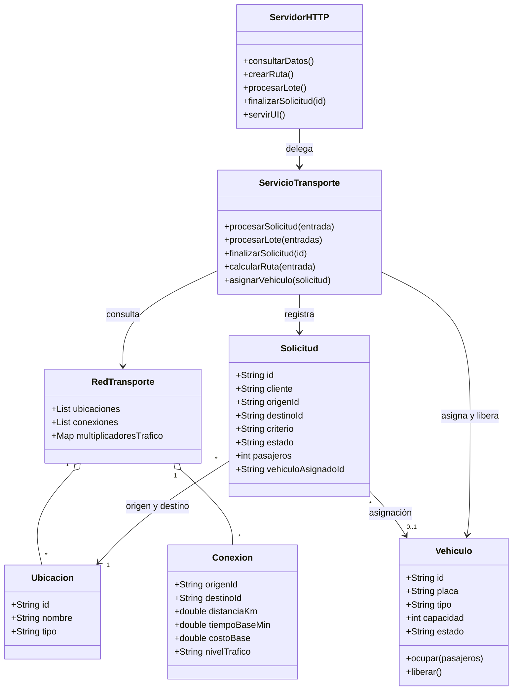
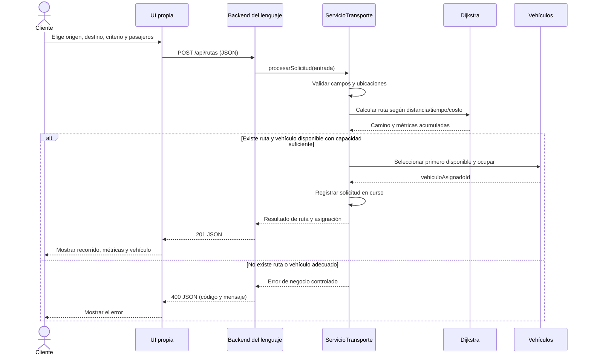
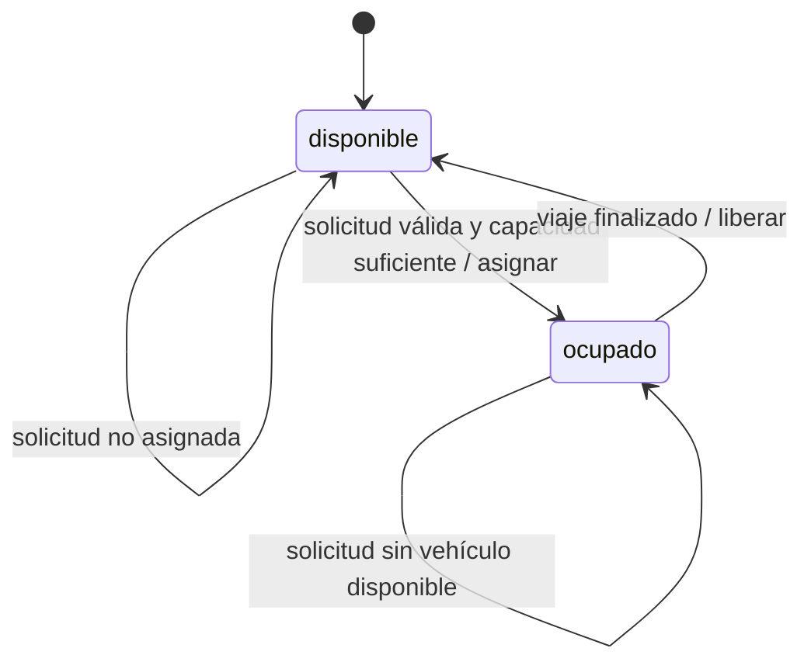

# Diagramas del sistema

Los diagramas muestran el diseño conceptual compartido. Cada lenguaje implementa sus propios componentes dentro de su carpeta y sirve su UI y API sin depender de las demás implementaciones.

## 1. Diagrama de clases y componentes de dominio

## 2. Diagrama de secuencia de una solicitud de ruta

## 3. Diagrama de máquina de estados del vehículo

Una transición de asignación solo se permite cuando la capacidad del vehículo es mayor o igual al número de pasajeros. Si una solicitud no encuentra vehículo, no cambia el estado de ningún vehículo.
